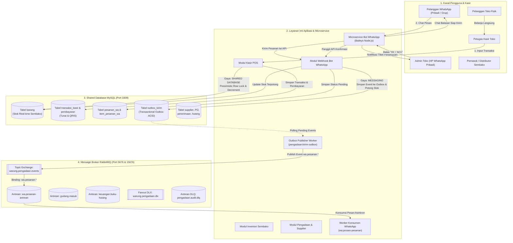

# Sistem Terintegrasi Warung Ibu Beti

**Mata Kuliah:** Integrasi Sistem dan Komputasi Awan (25IF1504)  
**Institusi:** STMIK Bandung  
**Kelompok:** Intel  

### Anggota Kelompok & Pembagian Tugas:
1. **Jacky Firmansah** (1224010) — *Ketua Tim, Bot WhatsApp Asinkron (RabbitMQ), Microservice Baileys & Test Automation*
2. **Arya Kusuma Dinata** (1224005) — *Infrastruktur Docker Sail, Health Check API & Master Katalog Inventori*
3. **Mochamad Aldi Ardiansyah** (1224020) — *Kontrak OpenAPI 3.1 (Stoplight Spectral), Modul Pengadaan Supplier & Utang Dagang*
4. **Andhi Yudha Permana** (1224017) — *Kasir POS Toko Fisik (Shared Database ACID) & Penanganan Galat RFC 9457*

---

## Berkas Deliverable Checkpoint 1 (Proyek Akhir 25IF1504)

1. **Kontrak API (OpenAPI 3.1 & Problem Details RFC 9457):** [`openapi.yaml`](./openapi.yaml)  
   *Design-first, bersih dari error linter Stoplight Spectral (0 errors, 0 warnings), skema data lengkap.*
2. **Kontrak Event Asinkron RabbitMQ:** [`KONTRAK_EVENT.md`](./KONTRAK_EVENT.md)  
   *Event bentuk lampau (`PesananWhatsAppMasuk`, `PesananWhatsAppDikonfirmasi`, `BarangDiterimaSupplier`, `TransaksiKasirSelesai`), topic exchange `warung.pengadaan.events`, routing key, skema JSON, publisher, dan consumer.*
3. **Microservice Bot WhatsApp Nyata (Baileys Node.js):** [`wa-bot/`](./wa-bot/)  
   *Modul bot WhatsApp multi-device (scan QR via HP) dengan alur konfirmasi persetujuan admin, mode kasir offline, dan restock instan.*
4. **Panduan Demo Lengkap & Cheat Sheet:** [`LANGKAH_DEMO_SIAP_SALIN_ANTI_ERROR.txt`](./LANGKAH_DEMO_SIAP_SALIN_ANTI_ERROR.txt)  
   *Contekan perintah 1-baris siap salin bebas error untuk 4 anggota kelompok.*
5. **Dokumen Analisis Arsitektur & Slide Presentasi:** *(Diserahkan terpisah via LMS / Dosen Penguji).*

---

## 1. Latar Belakang & Ringkasan Proyek

Proyek ini dibangun sebagai implementasi nyata dari **Lembar Kerja Tugas 3 & Checkpoint 1: Memilih Gaya Integrasi** untuk studi kasus **Warung Ibu Beti** (bisnis kelontong & sembako modern). Sistem ini mengintegrasikan seluruh operasional warung mulai dari transaksi kasir belanja langsung di toko fisik, pemesanan online via Bot WhatsApp, pembayaran digital (QRIS & Tunai), hingga pengelolaan rantai pasok / kulakan barang dari supplier.

Sesuai materi perkuliahan, proyek ini memadukan 3 gaya integrasi utama:
1. **Shared Database:** Diterapkan pada **Sistem Kasir (POS) ↔ Sistem Stok/Inventori**, karena beroperasi pada lokasi dan waktu yang sama di toko fisik serta membutuhkan pemotongan stok *real-time* dengan transaksi ACID atomik dan *Pessimistic Row-Locking* (`SELECT FOR UPDATE`).
2. **Messaging (Asynchronous via RabbitMQ):** Diterapkan pada **Bot Pemesanan WhatsApp ↔ Sistem Stok/Inventori**, karena kanal obrolan bersifat asinkron dan membutuhkan *loose coupling* dengan pola **Transactional Outbox** untuk mencegah *dual-write hazard*.
3. **Remote Procedure Invocation (REST API Level 2):** Seluruh layanan mengekspos endpoint API terstandarisasi berbasis spesifikasi OpenAPI 3.1.0 dengan format galat **RFC 9457 Problem Details** (`application/problem+json`).

---

## 2. Diagram Arsitektur Sistem



---

## 3. Komponen Layanan & Pemetaan Port Docker

Proyek ini berjalan di atas Docker Compose (Laravel Sail):

| Layanan | Kontainer | Port Host | Deskripsi |
| :--- | :--- | :--- | :--- |
| **Laravel API** | `warung_ibu_beti-laravel.test-1` | `8090` | Backend API utama, Controller RESTful, Artisan Commands |
| **MySQL Database** | `warung_ibu_beti-mysql-1` | `3309` | Shared Database, Transactional Outbox, Master Sembako |
| **RabbitMQ Broker** | `warung_ibu_beti-rabbitmq-1` | `5676` | AMQP Protocol untuk Topic Exchange & Queues |
| **RabbitMQ Management** | `warung_ibu_beti-rabbitmq-1` | `15676` | Web GUI Dashboard RabbitMQ (User: `sail`, Pass: `password`) |
| **Swagger UI** | `warung_ibu_beti-swagger-ui-1` | `8083` | Visualisasi interaktif OpenAPI 3.1 & uji endpoint langsung |
| **Microservice Bot WA** | `wa-bot/` (Node.js Baileys) | CLI / Host | Bot WhatsApp multi-device (scan QR dengan HP pribadi) |

---

## 4. Panduan Menjalankan Sistem

### Persyaratan Sistem:
- WSL 2 (Ubuntu) & Docker Desktop
- PHP 8.2+ / Composer (atau cukup jalankan lewat Docker Sail)

### Langkah 1: Kloning & Pengaturan Environment
```bash
git clone https://github.com/jackyfirmansah18/warung_ibu_beti.git
cd warung_ibu_beti
cp .env.example .env
```

### Langkah 2: Menjalankan Kontainer Docker Sail
```bash
./vendor/bin/sail up -d
```
Pastikan seluruh 4 kontainer berjalan sehat:
```bash
./vendor/bin/sail ps
```

### Langkah 3: Migrasi Database & Seeder Master Data
```bash
./vendor/bin/sail artisan migrate:fresh --seed
```
*Seeder otomatis mengisi master katalog: Beras Pandan Wangi 5kg (50 karung) dan Minyak Goreng Sawit 2L (40 pouch).*

### Langkah 4: Menjalankan Automated Tests (13 Tests, 40 Assertions)
```bash
./vendor/bin/sail artisan test
```
*Hasil: 13 test case lulus 100% PASS.*

### Langkah 5: Audit Linter OpenAPI 3.1 (Stoplight Spectral)
```bash
./vendor/bin/sail npx @stoplight/spectral-cli lint openapi.yaml --fail-severity=warn
```
*Hasil: `No results with a severity of 'warn' or higher found!` (0 errors, 0 warnings).*

---

## 5. Menjalankan Bot WhatsApp Nyata (Microservice Baileys)

Modul ini menghubungkan nomor WhatsApp pribadi atau WhatsApp grup menjadi kasir dan bot toko Warung Ibu Beti:

```bash
cd ~/warung_ibu_beti && ./vendor/bin/sail exec laravel.test node /var/www/html/wa-bot/index.js
```

1. **Scan Kode QR:** Buka WhatsApp di HP Anda $\rightarrow$ Titik Tiga / Pengaturan $\rightarrow$ *Perangkat Tertaut (Linked Devices)* $\rightarrow$ *Tautkan Perangkat* $\rightarrow$ Scan QR di terminal.
2. **Katalog & Stok:** Ketik `menu` untuk katalog, atau `stok` untuk cek sisa stok toko secara *real-time*.
3. **Pemesanan Pembeli:** Ketik `PESAN#Nama#Alamat#Kode SKU#Jumlah` (Contoh: `PESAN#Ibu Siti#Jl. Mawar 14#BRS-PREM-5KG#2`).
   * *Stok online BELUM terpotong sampai admin menyetujui.*
   * Pembeli menerima konfirmasi antrean pesanan.
4. **Persetujuan Admin Super Cepat:** Bot mengirim notifikasi ke chat pribadi Admin. Admin cukup membalas:
   * **`YA`** atau **`ACC`** $\rightarrow$ Menyetujui pesanan, memotong stok di MySQL, dan bot otomatis mengirim pesan konfirmasi pengiriman ke WhatsApp pembeli!
   * **`TOLAK`** $\rightarrow$ Membatalkan pesanan.
5. **Transaksi Kasir Offline (Khusus Admin):** Ketik `OFFLINE#BRS-PREM-5KG#1` di chat pribadi admin untuk mencatat penjualan langsung di toko fisik (stok langsung terpotong via Kasir POS).
6. **Restock Instan (Khusus Admin):** Ketik `RESTOCK#BRS-PREM-5KG#50` untuk menambah stok gudang secara instan.
7. **Dukungan Grup WhatsApp:** Bot dapat dimasukkan ke grup komunitas/RT. Anggota grup dapat memesan di grup, bot me-*mention* pembeli, dan notifikasi persetujuan tetap dikirim privat ke WhatsApp Admin.

---

## 6. Dokumentasi Endpoint REST API Utama

Dokumentasi interaktif dapat diakses melalui **Swagger UI** di: `http://localhost:8083`.

### A. Health Check
```bash
curl -s http://localhost:8090/api/v1/health | jq
```

### B. Katalog Stok Sembako (Inventori)
```bash
# Melihat Daftar Stok Barang
curl -s http://localhost:8090/api/v1/barang | jq

# Restock Stok Barang
curl -X PATCH http://localhost:8090/api/v1/barang/BRS-PREM-5KG/restock \
  -H "Content-Type: application/json" \
  -d '{"jumlah": 50}'
```

### C. Kasir POS (Gaya: Shared Database ACID)
```bash
curl -X POST http://localhost:8090/api/v1/kasir/transaksi \
  -H "Content-Type: application/json" \
  -d '{
    "kasir_nama": "Mbak Beti",
    "metode_bayar": "tunai",
    "uang_diterima": 200000,
    "items": [
      {"sku": "BRS-PREM-5KG", "qty": 2},
      {"sku": "MYK-GRG-2L", "qty": 1}
    ]
  }'
```

### D. Bot WhatsApp (Gaya: Messaging Asinkron via RabbitMQ)
```bash
# 1. Pelanggan Mengirim Pesanan (202 Accepted)
curl -X POST http://localhost:8090/api/v1/wa/pesanan \
  -H "Content-Type: application/json" \
  -d '{
    "nomor_telepon": "081298765432",
    "nama_pelanggan": "Ibu Siti",
    "alamat_antar": "Jl. Mawar No. 14",
    "metode_bayar": "tunai",
    "items": [
      {"sku": "BRS-PREM-5KG", "qty": 2}
    ]
  }'

# 2. Konfirmasi Pesanan oleh Admin (Memotong Stok)
curl -X POST http://localhost:8090/api/v1/wa/pesanan/latest/konfirmasi

# 3. Publish Event Outbox ke RabbitMQ
./vendor/bin/sail artisan pengadaan:kirim-outbox

# 4. Konsumsi Antrean RabbitMQ
./vendor/bin/sail artisan wa:proses-pesanan --timeout=5
```

### E. Pengadaan Supplier (Kulakan Restock & Utang Dagang)
```bash
# Mendaftarkan Supplier Baru
curl -X POST http://localhost:8090/api/v1/suppliers \
  -H "Content-Type: application/json" \
  -d '{
    "kode_supplier": "SUP-001",
    "nama": "PT Sumber Sembako Utama",
    "kontak": "081234567890",
    "limit_kredit": 20000000
  }'

# Penerimaan Barang Kulakan (Otomatis Menambah Stok Toko & Terbit Faktur Utang)
curl -X POST http://localhost:8090/api/v1/pesanan/1/terima-barang \
  -H "Content-Type: application/json" \
  -d '{
    "penerima": "Mang Udin (Gudang)",
    "catatan": "Barang utuh tidak cacat",
    "items": [
      {"sku": "BRS-PREM-5KG", "jumlah_diterima": 50}
    ]
  }'
```

---

## 7. Kesimpulan Arsitektur Integrasi

Proyek ini mendemonstrasikan keunggulan arsitektur integrasi sistem modern:
1. **Shared Database** memberikan performa instan dan konsistensi kuat (*ACID*) untuk transaksi kasir toko fisik dengan *Pessimistic Row-Locking* yang mencegah *overselling*.
2. **Messaging Pattern (RabbitMQ)** memberikan ketahanan (*resilience*) dan skalabilitas bagi kanal pemesanan WhatsApp daring tanpa risiko memblokir basis data kasir toko.
3. **Transactional Outbox Pattern** menjamin pesan event ke broker tidak akan hilang (*guaranteed at-least-once delivery*) bebas dari *dual-write hazard*.
4. **Alur Persetujuan & Bot Multi-Device** memberikan kendali operasional penuh bagi pemilik warung untuk menyetujui pengiriman barang dan menjaga sinkronisasi stok daring dengan stok fisik secara akurat.
