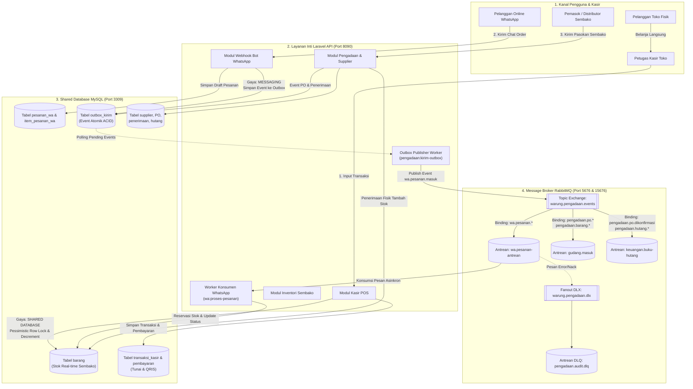
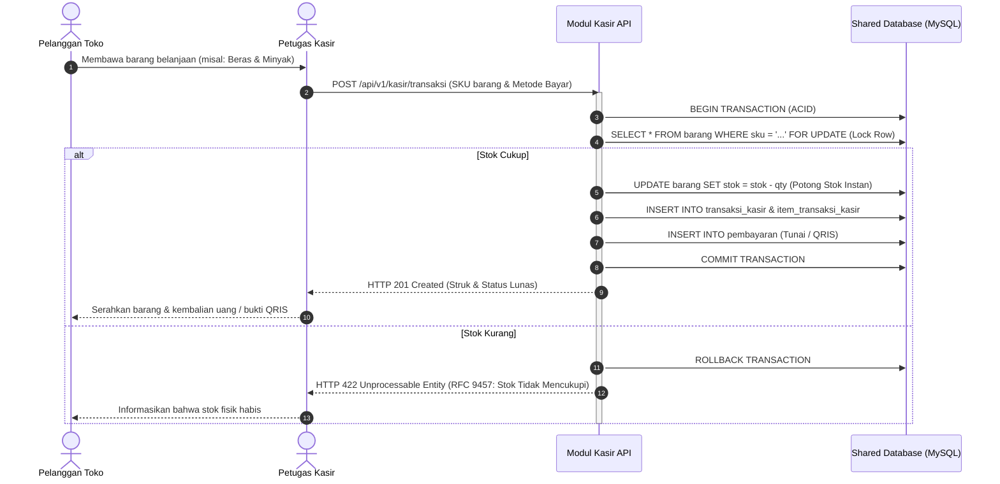
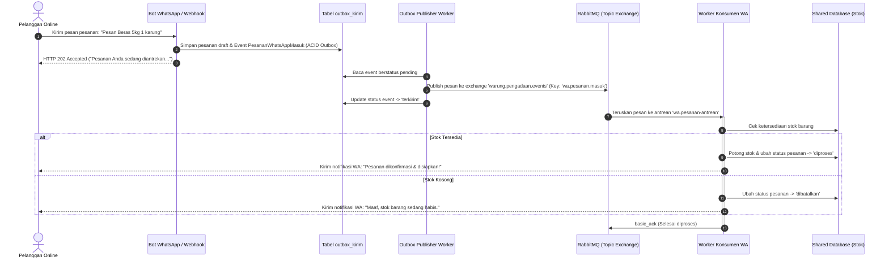
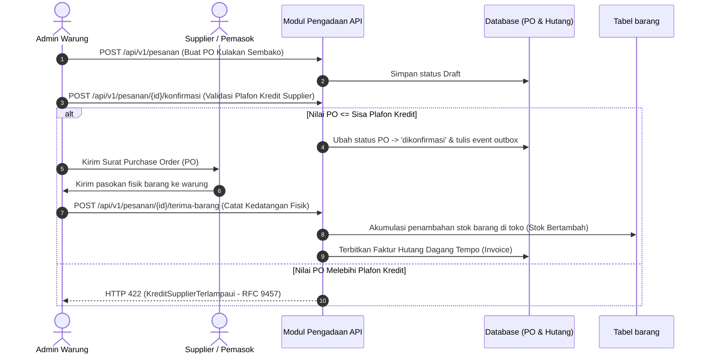

# Sistem Terintegrasi Warung Ibu Beti

**Mata Kuliah:** Integrasi Sistem dan Komputasi Awan (25IF1504)  
**Institusi:** STMIK Bandung  
**Kelompok:** Intel  

### Anggota Kelompok & Pembagian Tugas:
1. **Jacky Firmansah** (1224010)
2. **Arya Kusuma Dinata** (1224005)
3. **Mochamad Aldi Ardiansyah** (1224020)
4. **Andhi Yudha Permana** (1224017)

---

## Berkas Deliverable Checkpoint 1 (Proyek Akhir 25IF1504)

Seluruh berkas persyaratan Checkpoint 1 telah lengkap dan siap diperiksa:
1. **Dokumen Analisis (PDF, 6 Halaman):** `Dokumen_Analisis_Checkpoint_1_Warung_Ibu_Beti.pdf` *(diserahkan terpisah via LMS / Dosen)*  
   *Memuat konteks mitra, persoalan data silo, evaluasi trade-off 3 gaya integrasi, diagram 4 batas layanan, dan alur pemeriksaan 4 menit.*
2. **Kontrak API (OpenAPI 3.1 & Problem Details RFC 9457):** [`openapi.yaml`](./openapi.yaml)  
   *Design-first, bersih dari error linter Stoplight Spectral (0 errors), skema data lengkap.*
3. **Kontrak Event Asinkron RabbitMQ:** [`KONTRAK_EVENT.md`](./KONTRAK_EVENT.md)  
   *Event bentuk lampau (`PesananWhatsAppMasuk`, `BarangDiterimaSupplier`, `TransaksiKasirSelesai`), exchange `warung.pengadaan.events`, routing key, skema JSON, publisher, dan consumer.*
4. **Slide Presentasi (16:9 Widescreen):** `Presentasi_Checkpoint_1_Warung_Ibu_Beti.pptx` *(diserahkan terpisah via LMS / Dosen)*  
   *Dirancang khusus untuk presentasi 4 menit sesuai rubrik penilaian (Menit 0-1 Arsitektur, Menit 1-3 Demo, Menit 3-4 Q&A).*

---

## 1. Latar Belakang & Ringkasan Proyek

Proyek ini dibangun sebagai implementasi nyata dari **Lembar Kerja Tugas 3: Memilih Gaya Integrasi** untuk studi kasus **Warung Ibu Beti** (bisnis kelontong & sembako modern). Sistem ini mengintegrasikan seluruh operasional warung mulai dari transaksi kasir belanja langsung di toko fisik, pemesanan online via Bot WhatsApp, pembayaran digital (QRIS & Tunai), hingga pengelolaan rantai pasok / kulakan barang dari supplier.

Sesuai instruksi dan materi perkuliahan, proyek ini memadukan dua gaya integrasi utama:
1. **Shared Database:** Diterapkan pada **Sistem Kasir (POS) ↔ Sistem Stok/Inventori**, karena beroperasi pada lokasi dan waktu yang sama di toko fisik serta membutuhkan pemotongan stok *real-time* dengan transaksi ACID atomik.
2. **Messaging (Asynchronous via RabbitMQ):** Diterapkan pada **Bot Pemesanan WhatsApp ↔ Sistem Stok/Inventori**, karena kanal obrolan bersifat asinkron dan membutuhkan *loose coupling* agar penambahan kanal baru (misal aplikasi web) tidak mengubah sistem stok utama.
3. **Remote Procedure Invocation (REST API Level 2):** Seluruh layanan mengekspos endpoint API terstandarisasi berbasis spesifikasi OpenAPI 3.1.0 dengan format galat **RFC 9457 Problem Details** (`application/problem+json`).

---

## 2. Diagram Arsitektur Sistem

Arsitektur sistem memisahkan tanggung jawab transaksi belanja langsung, antrean pesan online, dan logistik pengadaan:



---

## 3. Rincian Alur Kerja Sistem (Flows)

Sistem mengimplementasikan tiga alur bisnis utama yang saling terhubung:

### Alur A: Transaksi Kasir POS (Gaya: Shared Database)
Alur ini melayani pelanggan yang datang langsung berbelanja ke warung fisik:



**Karakteristik & Trade-off (Sesuai Analisis Tugas 3):**
- **Application Coupling:** *Tight coupling*. Kasir dan stok berada di toko fisik yang sama.
- **Data Timeliness:** *Real-time*. Pemotongan stok terjadi detik itu juga tanpa menunggu antrean batch.
- **Synchronous vs Asynchronous:** *Synchronous*. Kasir menunggu kepastian ketersediaan stok sebelum struk dicetak.
- **Integrator Intrusiveness:** Sedang. Dirancang sebagai satu kesatuan sistem internal toko.

---

### Alur B: Pemesanan Online via Bot WhatsApp (Gaya: Messaging via RabbitMQ)
Alur ini melayani pelanggan yang memesan sembako dari rumah via chat WhatsApp:



**Karakteristik & Trade-off (Sesuai Analisis Tugas 3):**
- **Application Coupling:** *Loose coupling*. Provider API WhatsApp / Webhook dapat diganti kapan saja tanpa memengaruhi sistem stok.
- **Data Timeliness:** *Near real-time*. Pesanan diantrekan secara asinkron.
- **Synchronous vs Asynchronous:** *Asynchronous*. Pelanggan segera mendapat konfirmasi antrean, sementara reservasi stok berjalan di latar belakang.
- **Integrator Intrusiveness:** Rendah. Integrasi cukup melalui webhook dan message broker.

---

### Alur C: Logistik Pengadaan & Supplier (Rantai Pasok Hulu ke Hilir)
Alur ini melengkapi ekosistem warung agar barang yang habis dapat di-restock dari supplier:



---

## 4. Pemetaan Port Layanan

Port pada proyek ini telah dialokasikan secara independen agar seluruh modul berjalan dengan stabil:

| Layanan / Subsistem | Port Proyek (`warung_ibu_beti`) | Keterangan |
|---|---|---|
| **Aplikasi Laravel API** | **`8090`** | Base URL: `http://localhost:8090/api/v1` |
| **MySQL Database** | **`3309`** | DB: `warung_beti`, User: `sail`, Pass: `password` |
| **RabbitMQ AMQP Broker** | **`5676`** | Host broker untuk koneksi aplikasi |
| **RabbitMQ Web Dashboard** | **`15676`** | URL: `http://localhost:15676` (`beti` / `rahasia123`) |
| **Swagger UI (Dokumentasi API)**| **`8083`** | URL: `http://localhost:8083` |
| **Vite Dev Server** | **`5176`** | Frontend asset bundler |

---

## 5. Panduan Menjalankan Sistem

### Prasyarat
- Docker & Docker Compose
- WSL 2 (Ubuntu) bagi pengguna Windows

### Langkah 1: Menjalankan Kontainer Docker Sail
```bash
cd ~/warung_ibu_beti
./vendor/bin/sail up -d
```

### Langkah 2: Menjalankan Migrasi Database
```bash
./vendor/bin/sail artisan migrate
```

### Langkah 3: Menjalankan Uji Skenario Integrasi Tugas 3 (Otomatis)
Perintah ini mendemonstrasikan seluruh alur Tugas 3 secara otomatis:
```bash
./vendor/bin/sail artisan warung:uji-tugas3
```

**Hasil Uji Skenario Tugas 3:**
- [x] Inisialisasi stok beras & minyak goreng di inventori toko.
- [x] Transaksi kasir langsung memotong stok via **Shared Database** secara ACID.
- [x] Transaksi kasir digital dengan metode pembayaran QRIS.
- [x] Pesanan online pelanggan via Bot WhatsApp diterbitkan ke antrean **RabbitMQ (Messaging)**.
- [x] Worker konsumen WhatsApp (`wa:proses-pesanan`) mereservasi stok secara asinkron.
- [x] Proteksi galat standar RFC 9457 jika stok toko tidak mencukupi.

### Langkah 4: Menjalankan Automated Test Suite (PHPUnit)
```bash
./vendor/bin/sail artisan test
```
*Hasil: 12 feature & unit test lulus 100% (38 assertions).*

### Langkah 5: Menjalankan Worker Pesanan WhatsApp
Untuk memproses antrean pesan WhatsApp yang masuk secara berkala:
```bash
./vendor/bin/sail artisan wa:proses-pesanan
```

---

## 6. Dokumentasi Endpoint REST API & Contoh cURL

Dokumentasi interaktif dapat diakses melalui **Swagger UI** di: `http://localhost:8083`.

### A. Health Check
```bash
curl -X GET http://localhost:8090/api/v1/health
```

### B. Katalog Stok Sembako (Inventori)
```bash
# Menambah Barang Baru
curl -X POST http://localhost:8090/api/v1/barang \
  -H "Content-Type: application/json" \
  -d '{
    "sku": "TELUR-1KG",
    "nama_barang": "Telur Ayam Ras 1kg",
    "kategori": "sembako",
    "stok": 50,
    "harga_beli": 24000,
    "harga_jual": 28000,
    "satuan": "kg"
  }'

# Melihat Daftar Stok Barang
curl -X GET http://localhost:8090/api/v1/barang
```

### C. Kasir POS (Gaya: Shared Database)
```bash
# Transaksi Belanja Langsung di Kasir (Potong Stok Real-Time)
curl -X POST http://localhost:8090/api/v1/kasir/transaksi \
  -H "Content-Type: application/json" \
  -d '{
    "kasir_nama": "Mbak Beti",
    "metode_bayar": "tunai",
    "uang_diterima": 100000,
    "items": [
      {"sku": "TELUR-1KG", "qty": 2}
    ]
  }'
```

### D. Bot WhatsApp (Gaya: Messaging via RabbitMQ)
```bash
# Pelanggan Memesan via Chat WhatsApp
curl -X POST http://localhost:8090/api/v1/wa/pesanan \
  -H "Content-Type: application/json" \
  -d '{
    "nomor_telepon": "081298765432",
    "nama_pelanggan": "Ibu Siti",
    "alamat_antar": "Jl. Mawar No. 14",
    "metode_bayar": "tunai",
    "items": [
      {"sku": "TELUR-1KG", "qty": 1}
    ]
  }'

# Mengirim Pesan Tertunda ke RabbitMQ
./vendor/bin/sail artisan pengadaan:kirim-outbox

# Memproses Antrean Reservasi Stok
./vendor/bin/sail artisan wa:proses-pesanan
```

### E. Pengadaan Supplier (Restock Barang Masuk)
```bash
# Mendaftarkan Supplier
curl -X POST http://localhost:8090/api/v1/suppliers \
  -H "Content-Type: application/json" \
  -d '{
    "kode_supplier": "SUP-001",
    "nama": "PT Sumber Sembako Utama",
    "kontak": "081234567890",
    "limit_kredit": 20000000
  }'

# Penerimaan Barang Kulakan (Otomatis Menambah Stok Toko)
curl -X POST http://localhost:8090/api/v1/pesanan/1/terima-barang \
  -H "Content-Type: application/json" \
  -d '{
    "penerima": "Mang Udin (Gudang)",
    "catatan": "Barang utuh",
    "items": [
      {"sku": "TELUR-1KG", "jumlah_diterima": 50}
    ]
  }'
```

---

## 7. Kesimpulan Integrasi

Proyek ini telah membuktikan integrasi sistem komputasi awan yang modular dan andal:
1. **Shared Database** memberikan performa maksimal dan konsistensi instan untuk transaksi kasir fisik di toko.
2. **Messaging Pattern (RabbitMQ)** memberikan ketahanan (*resilience*) dan skalabilitas bagi kanal pemesanan online WhatsApp tanpa membebani basis data inti.
3. **Outbox Pattern** menjamin pengiriman pesan event ke broker tidak akan hilang (*guaranteed delivery*) meskipun terjadi gangguan jaringan atau server restart.
