# Layanan Pengadaan, Purchase Order, dan Manajemen Supplier ? Warung Ibu Beti

**Mata Kuliah:** Integrasi Sistem dan Komputasi Awan (25IF1504)  
**Institusi:** STMIK Bandung  
**Proyek:** Warung Ibu Beti (Sistem Sisi Pemasok / Pengadaan Barang)  

---

## ?? Ringkasan Proyek & Perbedaan dari Modul Dosen

Proyek ini dibangun berdasarkan referensi materi integrasi dosen (Remote Procedure Invocation / REST API Level 2 dan Asynchronous Messaging dengan RabbitMQ), namun dirancang dengan **alur domain, topologi message broker, skenario bisnis, serta alokasi port yang sepenuhnya berbeda** agar tidak bertabrakan dengan sistem yang sudah ada.

| Karakteristik | Modul Referensi Dosen (`toko-stok` & `warung-ibu-beti`) | Proyek Ini (`warung_ibu_beti`) |
|---|---|---|
| **Fokus Domain Bisnis** | Transaksi Kasir POS, Kasbon Konsumen Toko, & Rekap Omzet Kasir | **Sistem Pengadaan (Procurement), Purchase Order (PO), Penerimaan Barang, dan Hutang Dagang Supplier** |
| **Gaya Integrasi 1** | REST API Kasir & Pelanggan (Port 80, 8000) | **REST API Pengadaan & Supplier Level 2 (Port 8090)** |
| **Gaya Integrasi 2** | Asynchronous Event Outbox (`warung.sembako.events`) | **Asynchronous Event Outbox (`warung.pengadaan.events`)** |
| **Topologi Queue** | `kasir.buku-kas`, `gudang.stok-kritis` | `gudang.masuk`, `keuangan.buku-hutang`, DLQ `pengadaan.audit.dlq` |
| **Proteksi Finansial** | Limit Kasbon Pelanggan | **Limit Plafon Kredit Supplier (Tempo Purchase Order)** |
| **Port Aplikasi** | 8000 | **8090** |
| **Port MySQL** | 3306 / 3308 | **3309** |
| **Port RabbitMQ Broker** | 5672 / 5674 | **5676** |
| **Port RabbitMQ Dashboard** | 15672 / 15674 | **15676** |
| **Port Swagger UI** | 8080 / 8082 | **8083** |
| **Port Vite Dev** | 5173 / 5175 | **5176** |

---

## ??? 1. Diagram Arsitektur Sistem (Outbox Pattern & Message Broker)

```mermaid
flowchart LR
    subgraph S1 ["1. Aktor & Pengguna"]
        direction TB
        Logistik["?? Petugas Gudang / Kulakan"]
        AdminBeli["?? Admin Pembelian (PO)"]
        Keuangan["?? Bagian Keuangan"]
    end

    subgraph S2 ["2. Layanan Pengadaan (Laravel 12 REST API - Port 8090)"]
        direction TB
        API["?? REST API v1.0<br/>(Port 8090)"]
        DB[("??? MySQL (Port 3309):<br/>supplier, pesanan_pembelian,<br/>penerimaan_barang, hutang_dagang,<br/>outbox_kirim")]
        OutboxWorker["?? Outbox Publisher Worker<br/>(pengadaan:kirim-outbox)"]
    end

    subgraph S3 ["3. Message Broker (RabbitMQ - Port 5676 & 15676)"]
        direction TB
        ExEvents[["?? Topic Exchange:<br/>warung.pengadaan.events"]]
        QGudang[("?? Antrean:<br/>gudang.masuk")]
        QHutang[("?? Antrean:<br/>keuangan.buku-hutang")]
        ExDLX[["?? Fanout DLX:<br/>warung.pengadaan.dlx"]]
        QDLQ[("?? Dead Letter Queue:<br/>pengadaan.audit.dlq")]
    end

    %% Relasi
    AdminBeli -->|Buat & Konfirmasi PO| API
    Logistik -->|Input Barang Masuk| API
    Keuangan -->|Bayar Hutang Supplier| API

    API -->|1. Simpan Transaksi Bisnis & Event Atomik| DB
    DB -.->|2. Baca Pending Events| OutboxWorker
    OutboxWorker -->|3. Terbitkan Pesan Persistent| ExEvents

    ExEvents -->|Binding: pengadaan.po.*<br/>pengadaan.barang.*| QGudang
    ExEvents -->|Binding: pengadaan.po.dikonfirmasi<br/>pengadaan.hutang.*| QHutang

    QGudang -.->|Pesan Korup / Nack| ExDLX
    QHutang -.->|Pesan Korup / Nack| ExDLX
    ExDLX --> QDLQ
```



---

## ?? 2. Panduan Menjalankan Sistem (Docker Sail)

### Menjalankan Container
```bash
cd ~/warung_ibu_beti
./vendor/bin/sail up -d
```

### Menjalankan Migrasi Database
```bash
./vendor/bin/sail artisan migrate
```

### Menjalankan Seluruh Automated Tests
```bash
./vendor/bin/sail test
```

### Menjalankan Uji Skenario End-to-End
```bash
./vendor/bin/sail artisan pengadaan:uji-skenario
```

---

## ?? 3. Panduan Pengujian REST API (cURL)

### A. Health Check
```bash
curl -X GET http://localhost:8090/api/v1/health
```

### B. Mendaftarkan Supplier Baru
```bash
curl -X POST http://localhost:8090/api/v1/suppliers \
  -H "Content-Type: application/json" \
  -d '{
    "kode_supplier": "SUP-001",
    "nama": "PT Sumber Sembako Utama",
    "kontak": "081234567890",
    "alamat": "Jl. Soekarno Hatta No. 100",
    "limit_kredit": 20000000
  }'
```

### C. Membuat Purchase Order (Draft)
```bash
curl -X POST http://localhost:8090/api/v1/pesanan \
  -H "Content-Type: application/json" \
  -d '{
    "supplier_id": 1,
    "metode_bayar": "tempo",
    "keterangan": "Kulakan beras dan minyak goreng",
    "tanggal_pesan": "2026-10-21",
    "items": [
      {
        "sku": "BRS-5KG",
        "nama_barang": "Beras Pandan Wangi 5kg",
        "jumlah_pesan": 50,
        "harga_satuan": 70000
      },
      {
        "sku": "MYK-2L",
        "nama_barang": "Minyak Goreng 2L",
        "jumlah_pesan": 100,
        "harga_satuan": 38000
      }
    ]
  }'
```

### D. Konfirmasi Purchase Order (Memicu Outbox Pattern)
```bash
curl -X POST http://localhost:8090/api/v1/pesanan/1/konfirmasi
```

### E. Menerbitkan Event Tertunda dari Outbox ke RabbitMQ
```bash
./vendor/bin/sail artisan pengadaan:kirim-outbox
```

### F. Mencatat Penerimaan Barang di Gudang
```bash
curl -X POST http://localhost:8090/api/v1/pesanan/1/terima-barang \
  -H "Content-Type: application/json" \
  -d '{
    "penerima": "Mang Udin",
    "catatan": "Kondisi beras dan minyak bagus",
    "items": [
      {"sku": "BRS-5KG", "jumlah_diterima": 50},
      {"sku": "MYK-2L", "jumlah_diterima": 100}
    ]
  }'
```

### G. Membayar Hutang Dagang Supplier
```bash
curl -X POST http://localhost:8090/api/v1/hutang/1/bayar \
  -H "Content-Type: application/json" \
  -d '{
    "jumlah_bayar": 3000000
  }'
```

---

## ?? 4. Endpoint & URL Layanan

- **REST API Base URL:** `http://localhost:8090/api/v1`
- **Swagger UI Dokumentasi API:** `http://localhost:8083`
- **RabbitMQ Management Dashboard:** `http://localhost:15676` (User: `beti`, Password: `rahasia123`)
- **MySQL Port:** `3309` (User: `sail`, Password: `password`, Database: `warung_beti`)
